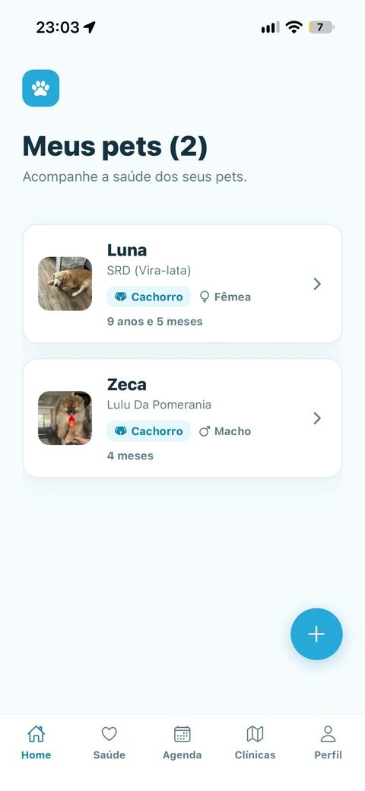
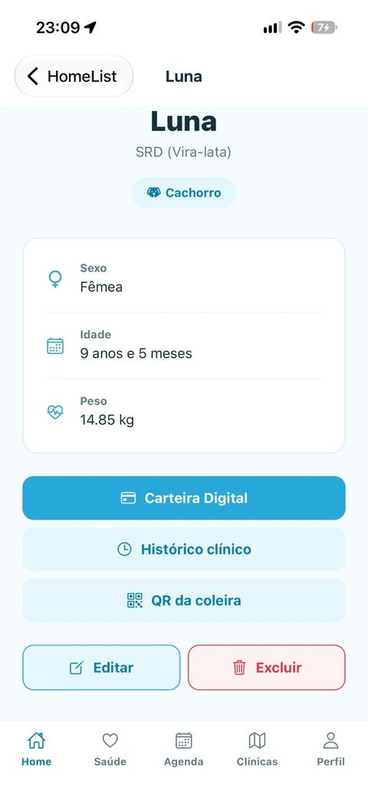
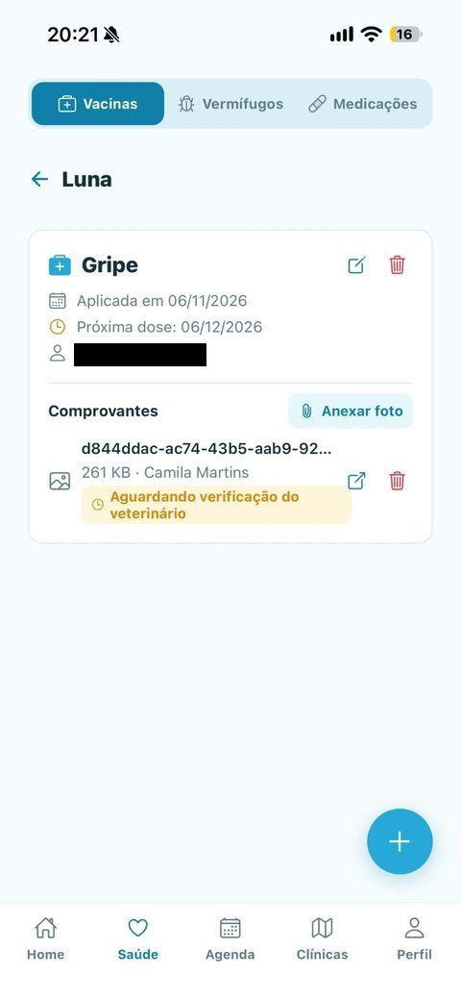
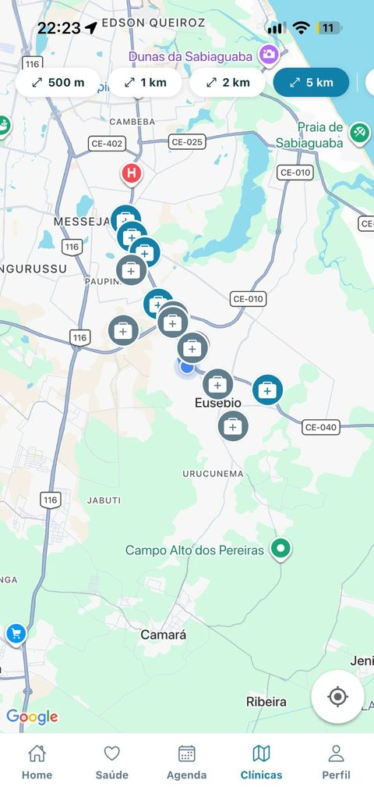
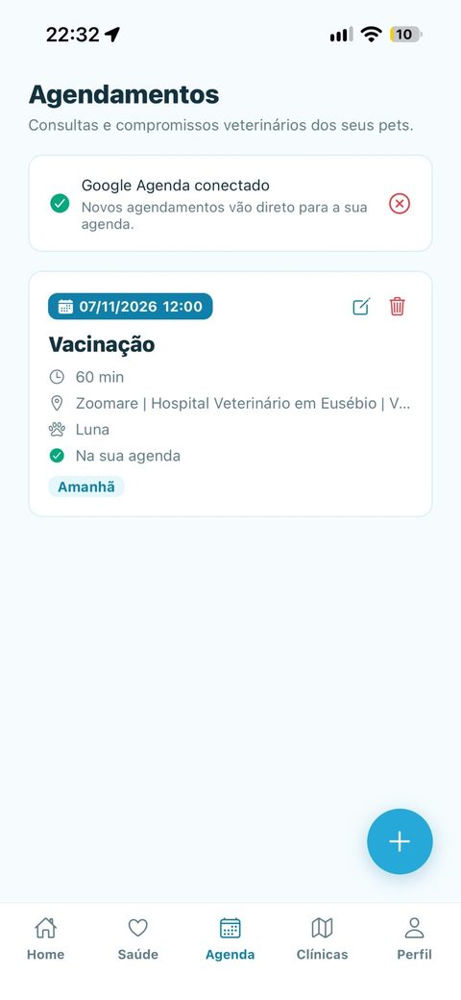

<div align="center">


# PetCard Mobile

**App do tutor do PetCard: a carteira de saúde do pet no celular, com lembretes de vacina, clínicas próximas e consultas na agenda.**

[](https://github.com/PetCardOrg/petcard-mobile/actions/workflows/ci.yml)
[](https://github.com/PetCardOrg/petcard-mobile/actions/workflows/ci.yml)
[](LICENSE)

[](https://expo.dev)
[](https://reactnative.dev)
[](https://www.typescriptlang.org)
[](#como-rodar)

[Telas](#telas) · [Funcionalidades](#funcionalidades) · [Stack](#stack) · [Como rodar](#como-rodar) · [Testes](#testes) · [Ecossistema](#ecossistema)

</div>

---

## Telas

<div align="center">








<sub>Meus pets · Perfil do pet · Saúde · Carteira digital · Clínicas próximas · Agenda</sub>

</div>

## Funcionalidades

| | |
|:-:|---|
| 🔐 | Cadastro, login, recuperação de senha e login com Google |
| 🐶 | Vários pets por tutor, com foto, raça, idade e peso |
| 💉 | Vacinas, vermífugos e medicações, com próxima dose e foto do comprovante |
| 🧾 | Histórico clínico com tudo o que tutor e veterinário registraram |
| 📱 | Carteira digital por QR Code ou link, com opção de regenerar o QR e exportar em PDF |
| 🏷️ | QR de coleira para pet perdido e mapa de onde ele foi encontrado |
| 📍 | Clínicas próximas no mapa, com filtro de raio e de funcionamento, ligação e rota |
| 📅 | Consultas sincronizadas com o Google Agenda |
| 🔔 | Notificações de próximas doses, de consultas e de quando o QR da coleira é lido |
| 🌐 | Interface em português e inglês, trocada no perfil |

## Stack

| Camada | Tecnologia |
|---|---|
| Framework | React Native 0.88 + Expo SDK 58 (development build) |
| Linguagem | TypeScript |
| Navegação | React Navigation 7 (stack, abas inferiores e abas superiores) |
| HTTP | Axios, com o token guardado no `expo-secure-store` |
| Mapas | `react-native-maps` + `expo-location` |
| Notificações | `expo-notifications` + Firebase Cloud Messaging |
| Login social | `@react-native-google-signin/google-signin` |
| Carteira em PDF | `expo-print` + `expo-sharing` |
| i18n | i18next + react-i18next (pt-BR e en-US) |
| Contratos | DTOs do [`@petcardorg/shared`](https://github.com/PetCardOrg/petcard-shared) |
| Testes | jest-expo + Testing Library |
| Build | EAS Build (perfis `development`, `preview` e `production`) |

```
src/
├── components/   componentes reutilizáveis
├── contexts/     sessão do tutor e pet selecionado
├── hooks/        hooks compartilhados
├── i18n/         traduções pt-BR e en-US
├── navigation/   pilhas e abas
├── screens/      uma pasta por área (Home, Saúde, Agenda, Clínicas, Perfil...)
├── services/     chamadas à API
├── test/         utilitários de teste
└── utils/        funções auxiliares
```

## Como rodar

**Pré-requisitos:** Node.js 20 LTS, npm 10, a [petcard-api](https://github.com/PetCardOrg/petcard-api) rodando, um token do GitHub com escopo `read:packages` (para baixar o `@petcardorg/shared`) e Xcode ou Android Studio.

O app usa módulos nativos (login com Google, mapas, push), então roda num **development build**, não no Expo Go.

```bash
git clone https://github.com/PetCardOrg/petcard-mobile.git
cd petcard-mobile

export NODE_AUTH_TOKEN=<seu_token_read_packages>
npm install

cp .env.example .env     # ajuste EXPO_PUBLIC_API_URL e a chave do Google Maps

npm run ios              # ou: npm run android (compila e instala o development build)
npm start                # nas próximas vezes, só o Metro
```

> No celular físico, `localhost` não alcança o seu computador: use o IP da máquina na rede ou um túnel (ngrok) em `EXPO_PUBLIC_API_URL`. As notificações push só funcionam em aparelho físico.

| Variável | Para quê |
|---|---|
| `EXPO_PUBLIC_API_URL` | Endereço da API |
| `EXPO_PUBLIC_GOOGLE_MAPS_API_KEY` | Mapa de clínicas |
| `EXPO_PUBLIC_GOOGLE_*_CLIENT_ID` | Login com Google (sem elas, o botão fica oculto) |

| Comando | O que faz |
|---|---|
| `npm start` | Sobe o Metro |
| `npm run ios` · `npm run android` | Compila e abre no simulador ou aparelho |
| `npm run lint` · `npm run typecheck` | ESLint e checagem de tipos |
| `npm test` · `npm run test:cov` | Testes, com cobertura |

> Para atualizar dependências, use `npx expo install --fix`. Um `npm audit fix` puro já desalinhou a toolchain do Expo uma vez.

## Testes

Os testes usam jest-expo e Testing Library e seguem a política de **cobertura de confiança** ([ADR-006](https://github.com/PetCardOrg/petcard-docs/blob/main/architecture/adr/006-cobertura-de-confianca.md)): cobrem regras que afetam o tutor, como horários de consulta, validação de registros de saúde e estado da sincronização com a agenda. Telas pesadas de mapa e notificação ficam de fora de propósito, por isso a catraca de cobertura é mais baixa que a da API e da web. O CI roda `lint`, `typecheck` e `test:cov` em todo push e PR para `main` e `develop`.

## Ecossistema

| Repositório | O que é |
|---|---|
| [petcard-api](https://github.com/PetCardOrg/petcard-api) | API REST em NestJS |
| [petcard-web](https://github.com/PetCardOrg/petcard-web) | Área do veterinário em React + Vite |
| **petcard-mobile** | App do tutor (você está aqui) |
| [petcard-shared](https://github.com/PetCardOrg/petcard-shared) | DTOs e enums compartilhados |
| [petcard-docs](https://github.com/PetCardOrg/petcard-docs) | Documentação central, ADRs e board |

Para contribuir, siga o [guia de contribuição](https://github.com/PetCardOrg/petcard-docs/blob/main/CONTRIBUTING.md). Projeto de TCC em Ciência da Computação, UNIFOR, 2026, por Álvaro Araújo, Camila Martins e Ricardo Temporal. Licença [MIT](LICENSE).
